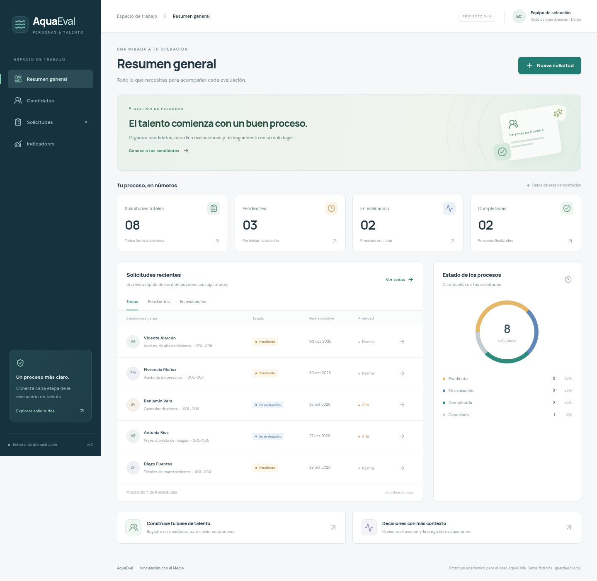

# AquaChile · Gestión de evaluaciones psicolaborales

Prototipo académico de frontend para la segunda entrega del proyecto de Vinculación con el Medio (VcM), asignatura DSY1104. Permite recorrer el proceso **candidato → solicitud → seguimiento**, con indicadores para consultar el avance de las evaluaciones.

La aplicación utiliza exclusivamente datos ficticios y guarda los cambios en `localStorage` del navegador. No envía información a un servidor, no realiza evaluaciones psicológicas ni toma decisiones de contratación. Es una demostración académica y no un producto oficial de AquaChile.



## Abrir en VS Code

Necesitas [Node.js](https://nodejs.org/) **24 LTS (24.15 o superior)** y VS Code. También es compatible con Node 22 desde 22.22.2. Comprueba la instalación en una terminal con `node --version` y `npm --version`.

1. Descarga o clona este repositorio.
2. En VS Code, selecciona **Archivo → Abrir carpeta** y abre `proyectoVcM`, la carpeta que contiene `package.json`. También puedes ejecutar `code .` desde esa carpeta.
3. Abre **Terminal → Nueva terminal** y ejecuta:

   ```bash
   npm ci
   npm run dev
   ```

4. Abre en tu navegador la dirección que indique Vite en la terminal.
5. Para detener el servidor, vuelve a la terminal y pulsa `Ctrl+C`.

No necesitas claves, un archivo `.env`, una base de datos ni servicios externos para esta entrega. En un entorno que ya tenga las dependencias instaladas, basta con ejecutar `npm run dev`.

## Qué puedes demostrar

- **Inicio:** consulta indicadores y solicitudes del proceso.
- **Candidatos:** busca personas ficticias, revisa sus datos y registra un nuevo candidato con validación de campos.
- **Solicitudes:** crea una evaluación asociada a un candidato, asigna responsable, fecha y prioridad, y busca o filtra las solicitudes.
- **Seguimiento:** consulta el detalle y actualiza el estado; el historial conserva la trazabilidad de los cambios en este navegador.
- **Indicadores:** revisa cantidades por estado a partir de los mismos datos de las solicitudes.

Los estados siguen este flujo:

```text
Pendiente ────────→ En evaluación ────────→ Completada
    │                    │
    └──→ Cancelada       └──→ Cancelada
```

`Completada` y `Cancelada` son estados finales. Una solicitud completada representa el cierre del seguimiento simulado; no genera un diagnóstico ni un informe profesional.

Los datos pertenecen al navegador y al origen desde el que abres la aplicación. Recargar conserva los cambios; otro navegador, otro puerto o borrar los datos del sitio puede mostrar nuevamente la demostración inicial. No uses datos personales reales.

## Comandos

| Comando                 | Uso                                                                |
| ----------------------- | ------------------------------------------------------------------ |
| `npm ci`                | Instala exactamente las versiones del archivo de bloqueo.          |
| `npm run dev`           | Inicia Vite para desarrollar.                                      |
| `npm test`              | Ejecuta Vitest una vez y devuelve su resultado.                    |
| `npm run test:watch`    | Repite las pruebas al editar archivos.                             |
| `npm run test:evidence` | Ejecuta las pruebas y actualiza la evidencia JSON en `artifacts/`. |
| `npm run build`         | Genera el frontend de producción en `dist/`.                       |
| `npm run preview`       | Sirve localmente el resultado de `npm run build`.                  |

Consulta los casos y resultados de la ejecución en [docs/PRUEBAS.md](docs/PRUEBAS.md) y la evidencia del runner en [artifacts/vitest-results.json](artifacts/vitest-results.json). La evidencia guardada no sustituye ejecutar `npm test` durante la presentación.

## Estructura y contenidos de clases

```text
src/
  components/     Componentes compartidos de interfaz
  context/        Estado compartido y persistencia local
  data/           Datos ficticios de demostración
  lib/            Validaciones, búsquedas, filtros y métricas
  pages/          Vistas del recorrido
  App.jsx         Integración y navegación de la aplicación
docs/             Requisitos, pruebas y guía de presentación
artifacts/        Evidencia de ejecución de pruebas
```

| Contenido                | Evidencia que debes explicar                                                                                                      |
| ------------------------ | --------------------------------------------------------------------------------------------------------------------------------- |
| React y Vite             | Inicio de la aplicación y composición de vistas en `src/`.                                                                        |
| Bootstrap 5 y responsive | Clases de rejilla, formularios y componentes en las vistas; comprueba el ancho de un teléfono con las herramientas del navegador. |
| Componentes y props      | Componentes de `src/components/` reciben información de las vistas.                                                               |
| Arrays y `.map()`        | Listados de candidatos, solicitudes e historial.                                                                                  |
| `useState` y eventos     | Estado de formularios, búsqueda y filtros; estado compartido en `src/context/`.                                                   |
| Renderizado condicional  | Errores de validación, búsquedas sin resultados y acciones disponibles según el estado.                                           |
| Formularios              | Registro de candidato y creación de solicitud; reglas en `src/lib/domain.js`.                                                     |
| React Router             | Rutas de inicio, candidatos, solicitudes, detalles e indicadores en `src/App.jsx`.                                                |
| Integración              | Una solicitud usa un candidato existente y sus cambios actualizan los indicadores.                                                |
| Vitest                   | Casos de validación, búsqueda, filtrado, métricas y transiciones junto a la lógica del dominio.                                   |

Para publicar el frontend en un alojamiento estático, configura una redirección de las rutas de la SPA a `index.html`; de lo contrario, abrir directamente una ruta de detalle puede producir un 404. La publicación no incluye un backend.

## Entrega y trabajo en equipo

El encargo representa el **40%** y la presentación individual el **60%** de esta evaluación. Cada integrante debe comprender y explicar su aporte real. Consulta el [alcance y requisitos](docs/REQUISITOS.md) y la [guía de presentación](docs/GUIA_PRESENTACION.md).

Antes de entregar, ejecuten las pruebas y la compilación, revisen los archivos y actualicen GitHub con cambios reales de cada integrante. Desde una copia del proyecto vinculada al repositorio:

```bash
git status
git branch --show-current
git add <archivos-que-revisaste>
git commit -m "Describe tu aporte real al proyecto"
```

Sustituye `<archivos-que-revisaste>` por los archivos concretos que quieras incluir. Después de revisar la rama y el remoto, publica según el flujo acordado por el equipo y verifica que el enlace entregado muestre la versión correcta. No inventes commits, autores ni evidencias de contribución; distribuyan tareas y registren el trabajo efectivo de cada persona.
